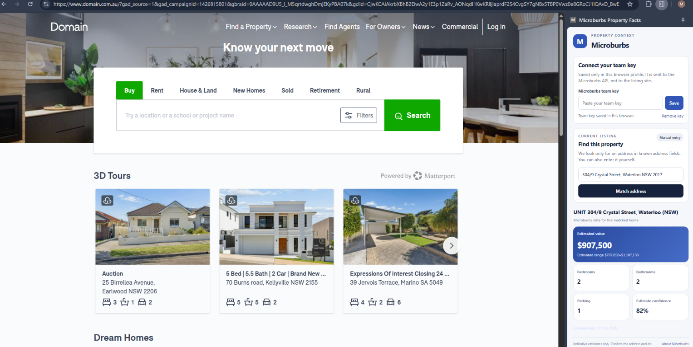
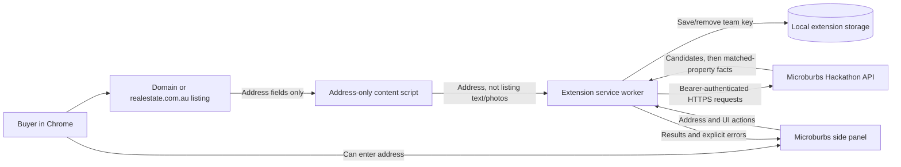

# BurbBuddy — Microburbs Property Facts

> **Hackathon submission · Chrome extension · City of Sydney API coverage**

**BurbBuddy** is the proposed product name for the Microburbs property-research companion. The current hackathon extension UI still uses **Microburbs Property Facts**; this README adopts the BurbBuddy product direction, but no extension code or interface branding has been changed. Check name, trademark, domain and Chrome Web Store availability before a public launch.

The extension brings matched Microburbs property information beside a buyer's listing on Domain or realestate.com.au. It reads only an address from address-specific page fields, or lets the buyer type one. It asks the Microburbs API to match that address and loads property facts only after an exact normalized match.

The extension prototype, report and pitch slides are implemented. The API flow and 15 automated test cases pass, and six live Waterloo listing addresses were checked against the API. This README documents the product, evidence, assumptions, installation, judge walkthrough and the key points to cover in the pitch and demo videos.

## At a glance

| | |
|---|---|
| **For** | Home buyers comparing a shortlist of properties |
| **Where** | Supported Domain and realestate.com.au listing pages; manual address entry is also available |
| **Adds** | Matched automated valuation, range, confidence and date when available, and property basics returned by the API |
| **Safety rule** | If there is no unique exact normalized address match, do not load or show property facts |
| **Coverage** | Hackathon API coverage is limited to the City of Sydney; individual facts may be unavailable |
| **Install** | Load the `chrome-extension` folder as an unpacked Chrome extension; no build step |

## Extension tested in Chrome

The screenshot below shows the extension panel open in Chrome on Domain. For this test, the address was **entered manually**; the panel then showed a matched Microburbs property, an estimated value and range, and available property basics. This demonstrates the manual lookup and results panel. It does **not** demonstrate automatic address detection from a property detail page.



*Chrome test screenshot: manual entry for 304/9 Crystal Street, Waterloo NSW 2017. The displayed estimate and facts are the API response shown in this test and should not be assumed for other properties or future lookups.*

### What this screen gives the customer—and how it could do more

The screenshot shows the current side panel's customer-facing path:

- **Connect a team key:** the user can save or remove the hackathon key in this browser profile.
- **Find this property:** the extension offers a manual address field and a **Match address** action. In this screenshot, the Domain page is its general home page, not a detail page for the Waterloo property; the user typed the Waterloo address manually.
- **Check the returned property:** after lookup, the panel shows the matched address and that Microburbs data belongs to that matched home.
- **Read the available context:** this response includes an estimated value and range, bedrooms, bathrooms, parking, estimate confidence and date.
- **Understand the limits:** the panel labels estimates as indicative and prompts the customer to confirm the address.

That is useful as a quick property lookup, but the screenshot also makes the next customer-value improvements concrete. These are **proposals, not controls currently shown in the screenshot**:

1. **Make the first-use path clearer:** when no key is saved, explain where the hackathon key comes from and how it is stored; after saving, collapse the setup area so the property lookup has more room. Never reveal or echo the secret key.
2. **Make match confidence legible:** show the listing/source address beside the Microburbs matched address, with a clear “matched” or “needs review” state. If there is no unique exact match, explain how to correct the address and do not show facts for another property.
3. **Explain the numbers in plain language:** add short help text for the AVM estimate, range, confidence and date, plus a visible caveat that an estimate is not an asking price, appraisal or sale guarantee.
4. **Compare guide and estimate only when both are reliable:** if permitted and robustly available, read the advertised guide from a specific listing price field, label its source, and show it next to the Microburbs estimate/range. Do not infer a price from page text or imply that the two values are directly equivalent; support price guides expressed as a range or “contact agent.”
5. **Add optional area context:** after validating exact API fields, show a separate expandable area card with a few relevant indicators, their geography and update date. Keep area-level data visually separate from facts about the individual property.
6. **Turn lookup into a buyer workflow:** add a **Save to shortlist** action, then a separate comparison view for a small number of homes. Save locally by default, show when data was last fetched, let the user remove a home, and mark unavailable values instead of displaying zero.
7. **Offer clear next actions:** allow the buyer to refresh the lookup or open the source listing; provide a discreet explanation/feedback path for an incorrect match or confusing field.

These changes would help a customer understand not just “what number did the API return?” but **which home it applies to, how to interpret it, what is missing, and how it compares with other options**. Start with match clarity and metric explanations, then test whether customers value the area card and shortlist before expanding the panel. Keep the current lightweight lookup as the default; do not turn the side panel into a dense data dashboard.

## High-level architecture



The content script is restricted to the two listing portals in the manifest. It checks address-oriented fields and listing headings; it does not collect listing descriptions or photos. The service worker—not the page script—adds the API authorization header. The API key is stored in Chrome extension storage in the local browser profile; it is not embedded in source files or sent to the listing page.

## Address-to-facts flow

```mermaid
sequenceDiagram
    actor Buyer
    participant Listing as Property listing
    participant Script as Content script
    participant Panel as Extension side panel
    participant Worker as Extension service worker
    participant API as Microburbs API

    Buyer->>Listing: Open a property listing
    Script->>Listing: Inspect address-specific fields only
    Script->>Worker: Send the detected address (or no address)
    Buyer->>Panel: Open extension; type address if needed
    Panel->>Worker: LOOKUP_ADDRESS(address)
    Worker->>API: GET /v1/geocode/address?address=...
    API-->>Worker: Candidate property IDs and display addresses
    Worker->>Worker: Normalize and require one exact match
    alt One exact match
        Worker-->>Panel: Matched property
        Panel->>Worker: LOAD_PROPERTY(matched ID)
        par Property basics
            Worker->>API: GET /v1/properties/{id}/basics/all
        and Automated valuation
            Worker->>API: GET /v1/properties/{id}/valuation/avm
        end
        API-->>Worker: Available data or a clear no-data response
        Worker-->>Panel: Show only fields returned by the API
    else No unique exact match
        Worker-->>Panel: Explain no exact match; load no property facts
    end
```

### Practical customer journey

1. A buyer opens a Domain or realestate.com.au property listing.
2. They click the Microburbs extension icon to open the side panel.
3. If an address is detected, they review it. Otherwise they enter the address themselves.
4. Microburbs returns address candidates. The extension requires one exact normalized match; it does not turn a merely similar suggestion into a property report.
5. After a match, the extension asks for property basics and an automated valuation from Microburbs.
6. The buyer compares the returned estimate, range and core facts with the portal's advertised information. Missing estimates or attributes are omitted or explained rather than invented.

The panel provides decision support, not a financial, building, legal or professional valuation. Buyers should verify facts independently and do their own due diligence.

## Value proposition and market differentiation

### The buyer problem

Property portals are useful for the listing itself: address, marketing, advertised guide, photographs and agent-provided features. Buyers still need context to compare homes consistently and understand an automated estimate's range and confidence.

### What this prototype adds

- **A matched property estimate and range:** gives a buyer another reference alongside the seller's advertised guide.
- **Confidence and date, when supplied:** makes the estimate less like an unexplained single number.
- **Core property basics:** bedrooms, bathrooms, parking, dwelling type and land area when the API returns them.
- **Inline comparison:** places context beside a listing, reducing tab-switching during a shortlist review.
- **Address-first, minimal collection:** it reads only the address needed to retrieve the selected property's facts; it does not copy listing text or photos.
- **An explicit mismatch state:** a failed exact match stops the facts lookup instead of showing the data of a potentially different property.

### Differentiation—positioning, not a claim of being the only product

The differentiator is the **combination** of Microburbs' matched property-level estimate/range/confidence and physical basics in a lightweight listing companion, with a conservative address-match rule. It is designed to complement campaign-history tools, not claim that competitors do not offer property insights.

The hackathon brief itself describes a rival listing-history extension. Public product descriptions checked for this submission include:

- [Homer](https://www.homerapp.com.au/) describes guide-price changes, campaign history and agent pricing insights for Australian listings.
- [Property Track](https://www.propertytrack.co/) describes asking-price history for Rightmove, plus paid comparables, recent sales and trends.
- [Domain](https://www.domain.com.au/) and [realestate.com.au](https://www.realestate.com.au/) provide the underlying listing experience and advertised information.

This is a comparison of public product positioning, not a hands-on competitor benchmark. Products and offers can change. A larger extension partner or its user base is a **possible distribution channel**, not a partnership, endorsement, committed number of users or guaranteed conversion.

### Market signals (not a market-size estimate)

The [hackathon brief](https://www.microburbs.com.au/p/hackathon-task-chrome-extension) reports a property-search extension founder's estimate of about **52,000–54,000 downloads** and describes a rival listing-history extension with about **10,000 active users**. These are event-provided, attributed signals—not independently audited figures, unique buyers, this product's audience, a conversion forecast or evidence of partnership. They suggest a browser extension can be a plausible distribution format; a production business case still needs permission, a measured pilot and validated user research.

## Product blueprint: turn the extension into a buyer decision companion

This section is a **future product and delivery blueprint**, not a list of features already implemented. The current hackathon prototype demonstrates the starting point: address-first lookup, exact normalized matching, property basics and an automated valuation where the API has them. The opportunity is to develop that single-property lookup into a trustworthy workflow for understanding a home, understanding its area, and comparing a small shortlist.

### Product vision

> **Help a buyer move from “What does this listing say?” to “What do I know, what is still uncertain, and how does this home compare with my other options?”**

Keep the extension focused on a buyer's active research moment. It should enrich the listing with licensed Microburbs data, explain the source and limits of each insight, and help the buyer make their own decision. It should not claim to recommend a property, predict a sale price with certainty, or replace a building inspection, conveyancer, lender or local research.

### Proposed customer experience

1. **Recognize the listing:** detect or let the buyer enter the address; show the source address and the Microburbs match side by side.
2. **Verify before enriching:** require a unique match and expose the matched property identifier and match status. If it is ambiguous or not exact, stop and request correction rather than showing potentially unrelated facts.
3. **Understand the property:** present available property basics and AVM estimate, range, confidence and date with short explanations and source/freshness labels.
4. **Understand the area:** offer a separate, optional area-context view using relevant suburb or area data after confirming each field, geography, date, and permitted use in the API contract.
5. **Compare a shortlist:** let the buyer save a few properties and compare equivalent fields in one view. Clearly distinguish “not available” from zero, and distinguish property facts from area-level statistics.
6. **Choose a next step:** let the buyer revisit saved comparisons or open the source listing. Any export or share action should be opt-in and should not expose the team's API key or unnecessary personal data.

### Feature roadmap and customer value

| Priority | Proposed capability | Feasibility | Customer value | Microburbs value | Gate before release |
|---|---|---|---|---|---|
| **P0: Trustworthy property card** | Match status, matched address, returned property basics, AVM range/confidence/date, clear unavailable/error states, and a concise explanation of each metric | **High; mostly presentation and validation work** on top of existing API calls | Makes data easier to assess and reduces the chance of comparing the wrong property or treating missing data as zero | Demonstrates Microburbs property data at the point a buyer is evaluating a home | Confirm API semantics, freshness, licensing, accuracy statements, and correct behavior on matched, unmatched, missing-data and error cases |
| **P1: Area context** | A buyer-opened section for a small, curated set of relevant suburb/area indicators—for example market, demographic, school or risk information only where documented and appropriate | **Likely; API-informed, field validation required.** Documentation describes suburb/area capabilities, but each field must be checked for availability and suitability | Adds context that a listing page may not put into a consistent, comparable format | Introduces more of Microburbs' suburb/area data and can show its breadth beyond valuation | Inventory documented endpoints and schemas; validate coverage, geography, dates, definitions, source rights and suitability of every displayed field |
| **P1: Local shortlist comparison** | Save a small number of matched listings locally and compare common property and selected area fields | **High; extension-side feature.** Does not require a new API endpoint for basic local saving and comparison | Helps buyers compare options without repeatedly switching tabs or relying on memory | Encourages repeat use and makes multiple Microburbs data products useful in one workflow | Test local data minimization, deletion, stale-data handling, comparable field definitions and accessibility |
| **P2: Buyer-defined suburb finder** | Let a buyer choose and adjust filters, then explore/rank covered suburbs with visible criteria and explanations | **Possible; endpoint is documented, UX and response behavior need validation** | Helps buyers translate personal priorities into a transparent exploration flow | Makes documented suburb-finder capabilities discoverable and useful | Verify available fields, units, sorting/filter behavior, coverage, fairness risks and whether results are explainable |
| **P2: Saved research and revisit** | Optional notes, saved comparisons, freshness indicators and reminders to refresh data | **Technically feasible; mainly extension/product work.** Sync/reminders across devices would add backend and account complexity | Helps a buyer continue research over time | Creates a reason to return and supports product learning from opt-in engagement | Add only with clear consent, retention/deletion controls and privacy review; do not infer sensitive traits |
| **Later, only if validated** | Shareable/exportable reports, alerts, professional referrals or paid tiers | **Feasible but materially larger; likely needs backend, accounts or partners** | Could support handoff or ongoing research if buyers request it | Could create qualified engagement or revenue paths | Validate user demand, API/data rights, partner terms, operational cost and compliance before investing |

### Feasibility and evidence basis

The roadmap is a practical engineering proposal, not a claim that the features are already built. It combines three kinds of evidence:

- **Implemented foundation:** the current prototype already has the extension UI, address lookup, exact normalized match guard, property basics/AVM calls, and local extension storage. The new trustworthy-card work is therefore a contained improvement to existing code, though it still needs browser validation.
- **Documented API opportunities:** Microburbs' published [API docs](https://api-ht.microburbs.com.au/docs) and [OpenAPI schema](https://api-ht.microburbs.com.au/openapi.json) describe property basics and AVM, suburb/address geocoding, suburb-finder fields/search, and area-statistics fields/values. That makes area context and a criteria-driven suburb finder **plausible API-backed features**. It does not prove that every example category (such as schools or risk indicators) has an appropriate, sufficiently current field for the intended customer experience; confirm exact endpoint schemas and live responses before committing to a design.
- **Extension/product design proposals:** local shortlist storage, side-by-side comparison, explanatory labels, saved notes, and the proposed customer journey are design choices, not API capabilities. They are technically conventional extension features, but usefulness, privacy, compatibility and user demand still need testing.

No separate external technical source or competitor feature was used to claim that these enhancements already exist. Competitor references elsewhere in this README describe publicly stated market positioning only. Before implementation, build an endpoint-to-screen field map from the current API docs, make representative authorized requests, and confirm API terms, coverage, freshness, rate limits and data-use permissions with Microburbs. Treat the ratings above as **engineering feasibility**, not guarantees of data availability, customer adoption, commercial approval or judging outcome.

### Recommended build order

1. **Trustworthy property card:** improve match visibility, metric explanations and freshness/unavailable states using the current property workflow.
2. **One area-context card:** select only fields verified in the API contract and representative responses; keep property-level and area-level facts visually distinct.
3. **Local shortlist comparison:** save a few properties locally and compare equivalent, available fields with clear stale-data and delete behavior.
4. **Buyer-defined suburb finder:** explore documented finder fields/search only after validating result behavior and presenting transparent user-selected criteria.
5. **Backend-dependent ideas:** consider cross-device sync, alerts, sharing, referrals or paid features only after user demand, API permission and production credential needs are established.

This sequence is feasible because it extends the existing address-to-property flow first, then adds a small validated data surface, then user-controlled comparison. It avoids prematurely building a broad dashboard or opaque recommendation engine.

### Differentiation to aim for

Avoid trying to win by adding the largest number of API endpoints. Aim for a cohesive and credible experience competitors can recognize:

- **At-listing context:** bring Microburbs data to the moment the buyer is evaluating a property.
- **Property plus place:** connect an individual home's available facts with clearly labeled area context, without conflating the two.
- **Transparent uncertainty:** show the estimate range, confidence/date and missing-data states instead of a bare number or invented completeness.
- **Trustworthy identity:** make address matching visible and fail closed on ambiguity.
- **Buyer-controlled comparison:** let users choose which properties and criteria matter to them rather than issuing opaque “best home” or “best suburb” recommendations.
- **A privacy-conscious interaction:** use the minimum information required, avoid collecting listing descriptions/photos, and keep saved research under user control.

This is a product-positioning hypothesis, not a claim that no competitor has any of these capabilities. Validate differentiation with hands-on competitor testing and buyer interviews.

### How this can create value for customers and Microburbs

**For buyers**

- Less tab switching when reviewing a property shortlist.
- A second, clearly qualified value reference alongside the seller's guide—not a replacement for it.
- More consistent comparison of returned property basics and, if validated, area-level context.
- Better visibility into what is known, when it was updated, and what is missing.
- More control over the comparison criteria, with no pressure to treat an algorithmic ranking as advice.

**For Microburbs**

- A practical distribution surface for property and suburb data at the point of property research, subject to portal rules and approved API use.
- A way to demonstrate how multiple data products work together in one customer workflow.
- A potential product-led discovery or acquisition channel; reach and conversion must be measured, not inferred from other extensions' reported audiences.
- Structured, opt-in evidence about which data customers use, where coverage gaps occur and what explanations they need.
- Potential future partner, subscription or lead-generation models, only after commercial terms, user demand, unit economics and regulatory obligations are validated.

The extension should make Microburbs' data more understandable and actionable—not suggest that an automated estimate is guaranteed, that an area indicator determines an individual buyer's outcome, or that Microburbs endorses a purchase.

### Technical and operational blueprint

**Prototype evolution**

- Keep the content script narrow: detect only address-specific fields, do not scrape listing descriptions/photos, and retain manual entry.
- Keep the service worker responsible for API calls, validation, match checks and user-readable error states.
- Add an API adapter that normalizes response envelopes, validates expected fields and represents `available`, `not available`, `outside coverage`, `error` and `stale` as distinct states.
- Fetch only the data needed for the selected property and only fetch area context when the buyer opens it. Respect the documented per-key rate limit; use caching only with explicit freshness and invalidation behavior.
- Add automated tests for each new field, geography, data-absent case, API error and match edge case; add browser end-to-end checks for the supported portals.

**Production evolution**

- Confirm written API licensing, permitted customer-facing use, quotas, cache rules, attribution, retention, support and commercial pricing with Microburbs.
- Replace a shared team key stored in an extension profile with an API-approved authentication design. A production backend should protect credentials, enforce quotas, validate requests, and avoid logging secrets or unnecessary address histories.
- Document data provenance, field definitions, geography, update cadence and limitations in the UI. Provide privacy notice, consent where needed, deletion/export controls for user-saved data, and an incident/support process.
- Make accessibility, performance, API degradation, browser compatibility, release signing, monitoring and rollback part of launch readiness.
- Use opt-in, aggregate product analytics. Do not retain a user's browsing history or listing addresses by default; measure only what is needed and clearly disclose it.

### Delivery plan with decision gates

1. **Validate the API and rights:** inventory endpoints and fields; confirm coverage, semantics, freshness, licensing, rate limits and credential options. Produce a field catalogue with data owner, geography, date, null behavior and customer explanation.
2. **Prove the core journey:** run moderated buyer sessions with the existing property card. Measure whether users understand the match, estimate range/confidence and missing-data states. Fix mismatches and confusing labels before adding breadth.
3. **Prototype one area-context card:** choose a small set of fields only after validation. Test comprehension, usefulness, perceived bias and whether buyers can distinguish property-level from area-level information.
4. **Pilot shortlist comparison:** offer a limited, local-first saved list. Test repeat usage, field comparability, deletion and stale-data behavior.
5. **Run an opt-in pilot:** test with a defined audience and permitted listings. Review reliability, usefulness, API cost and customer feedback before deciding on distribution or monetization.
6. **Production-readiness decision:** proceed only with approved commercial/API terms, secure authentication, privacy and legal review, support ownership, measured demand, and an acceptable unit-economics case.

At each gate, stop or revise features that confuse users, imply unsupported certainty, create unacceptable privacy/compliance risk, or do not show evidence of customer value.

### Success measures

Set baselines and targets with Microburbs and pilot users before launch. Useful measures include:

- **Address quality:** detection rate, unique exact-match rate, false-match rate, manual correction rate and mismatch-stop behavior. Treat false matches as a critical quality issue.
- **Data usefulness:** API availability by field and geography, successful fact loads, freshness, and proportion of users who understand the estimate/range explanation.
- **Customer value:** time to compare a shortlist, completed comparisons, repeat use, reported confidence in understanding data (not confidence that a property is “right”), and qualitative interview feedback.
- **Reliability:** API success/latency, rate-limit and timeout rates, extension errors, browser compatibility and support burden.
- **Microburbs value:** incremental engaged users, opt-in activation/retention, data-product discovery, partner referrals where agreed, and cost per useful matched session.
- **Business viability:** API and serving cost per active user, retention, willingness to pay, conversion and contribution margin if a paid model is tested.

Do not treat downloads, page views, displayed facts, estimated valuation accuracy, or a judge's reaction alone as proof of sustained customer value or commercial ROI.

### Key assumptions and risks to resolve

- The hackathon API's City of Sydney coverage and field availability may not support a broader launch; verify production coverage before defining the target market.
- Portal markup and terms can change. Maintain supported-site boundaries and do not bypass site controls or collect more than needed.
- Text normalization is not legal-property identity proof; preserve the visible match confirmation and fail-closed behavior.
- Area indicators can be misunderstood, become stale, or create unfair/discriminatory interpretations. Use carefully selected fields, clear definitions and geography, and avoid sensitive-trait targeting or opaque rankings.
- An API key in extension storage is acceptable only for the hackathon arrangement; it is not the proposed production credential model.
- API rights, product pricing, extension partnerships, conversion, customer demand, costs and financial returns remain hypotheses until confirmed by written terms and pilot evidence.

## Technology stack

### Hackathon submission: Chrome extension

| Component | Technology | Role |
|---|---|---|
| Extension | Chrome Manifest V3 | Permissions, supported portal URL patterns, side panel and service worker |
| Listing integration | Vanilla JavaScript content script | Reads address-oriented DOM fields and reports an address to the extension |
| UI | HTML, CSS and vanilla JavaScript | Side panel, key setup, address confirmation, loading/error/empty states, fact cards |
| Background/API layer | Chrome extension service worker, Fetch API | Stores the key, calls the Microburbs API, checks matches, handles errors and caches successful responses in memory |
| Local settings | `chrome.storage.local` | Keeps the team key in the local browser profile, not in the repository |
| API | Microburbs Hackathon REST API over HTTPS | Address geocoding and property basics/valuation |
| Tests | Node.js built-in `node:test` and `node:assert` | Tests API workflow, address matching, errors and address-only extraction without additional test packages |

**No framework, package installation, compile or build is required for the Chrome extension.** It requires an authorized Chrome profile that permits loading an unpacked extension and network access to the API.

### Other examples in this repository

The repository also contains separate API learning/demo apps. They are **not dependencies of the Chrome extension**:

| Folder | Stack | Purpose |
|---|---|---|
| [`chrome-extension/`](chrome-extension/) | Chrome Manifest V3, HTML/CSS/JavaScript | This hackathon submission |
| [`nextjs-suburb-map/`](nextjs-suburb-map/) | Next.js App Router, React, TypeScript, MapLibre, Tailwind CSS | City of Sydney map, suburb explorer, listings, property reports and API inspector |
| [`fastapi-property-report/`](fastapi-property-report/) | FastAPI, Python, Jinja2, htmx, Tailwind CSS, Leaflet | Server-rendered property and suburb reports |
| [`streamlit-property-explorer/`](streamlit-property-explorer/) | Python, Streamlit, pydeck | Interactive property and suburb exploration |
| [`python-quickstart/`](python-quickstart/) | Python, Jupyter, pandas, requests | Reproducible API walkthrough, table and chart |

## Install and use the extension

### Requirements

- Google Chrome 116 or later (Manifest V3 side panel support).
- Permission to use **Developer mode** and load an unpacked extension. Organization-managed browsers may prohibit this; do not bypass their policy.
- A valid Microburbs hackathon team key.
- Network access to `https://api-ht.microburbs.com.au`.

### Installation (Windows)

1. Locate this repository on disk and open Chrome.
2. Go to [`chrome://extensions`](chrome://extensions).
3. Turn on **Developer mode** if your browser permits it.
4. Select **Load unpacked**.
5. Choose the repository's `chrome-extension` folder (the folder containing `manifest.json`).
6. Open a listing on Domain or realestate.com.au and click the **Microburbs Property Facts** extension icon.
7. In **Connect your team key**, paste the key and click **Save**.
8. Check the detected address, or type the listing address. Check the selected match before relying on its facts.
9. To remove the key later, click **Remove key** in the panel.
10. After changing extension files, return to `chrome://extensions` and click **Reload** on the extension card.

### Installation (macOS/Linux)

Follow the same steps in Chrome. In **Load unpacked**, select the `chrome-extension` folder using that operating system's file picker.

For the concise extension-only setup and live-demo checklist, see [`chrome-extension/CHROME-EXTENSION-SETUP.md`](chrome-extension/CHROME-EXTENSION-SETUP.md).

### Team-key safety

The extension key and the server demos' `.env` key are configured separately. The Chrome extension **does not read `.env`**; paste the key into its panel. Keep it private, do not commit it, and do not show it in screenshots or the demo recording. Removing the key clears it from that extension's local browser storage.

The extension service worker sends the key to the Microburbs API in the HTTPS `Authorization` header. The key is not a production-grade end-user credential vault: restrict the local browser profile and follow Microburbs' key and API terms. A commercial release should move credentials to a properly authenticated backend or use an API credential model approved by Microburbs.

## What is implemented—and what is not

### Implemented

- MV3 extension manifest, supported portal content-script patterns, toolbar action and side panel.
- Key setup, local storage, removal and clear missing-key feedback.
- Address detection from address-specific selectors/headings, plus manual address entry.
- Microburbs geocoder and normalization for case, punctuation, state/postcode suffixes, common road-type abbreviations and unit prefixes.
- A fail-closed match rule: only a **unique exact normalized** match may load property data. Ambiguous or non-exact suggestions do not load facts.
- Matched-property calls to `/basics/all` and `/valuation/avm`.
- Valuation range, confidence/date and property basics where present; missing and placeholder data such as `nan` is not displayed as a fact.
- Helpful states for API authentication errors, coverage errors, rate limits, server/network failures, timeouts, missing data and malformed responses.
- A one-hour in-memory response cache with a bounded cache size.
- Pitch deck in [`chrome-extension/pitch-deck.html`](chrome-extension/pitch-deck.html) and [`chrome-extension/pitch-deck.pdf`](chrome-extension/pitch-deck.pdf); comparison report in [`chrome-extension/report.html`](chrome-extension/report.html).
- Automated tests in [`chrome-extension/tests/extension.test.js`](chrome-extension/tests/extension.test.js).

### Scope and limitations

- API data is not complete for every property. A match does not guarantee an AVM, bedrooms or other details.
- This is a local hackathon prototype, not a published Chrome Web Store release, managed service, commercial SLA or production-secured account system.
- No scored CSV is required by the task brief.

## Judge-criteria status

The challenge brief says judges will open several real listings, check each matched address and its facts, assess buyer value, and consider the pitch, demo and report. It also explicitly says there is no scored CSV. The live-demo runbook below provides a repeatable walkthrough and checklist; the README also contains the product story and points to cover in the pitch and demo videos.

| Judge expectation | Evidence and walkthrough in this submission |
|---|---|---|
| Mature end-to-end extension on real listings | MV3 implementation, API-flow tests, live API spot-check and the step-by-step Chrome walkthrough in the runbook |
| Correct address and facts for each listing | Unique exact-match rule, no facts loaded for a non-exact suggestion, and five unique exact matches in a six-address Waterloo API spot-check; the runbook tells judges how to compare listing and API addresses |
| Useful buyer-selected facts | Estimate/range, confidence/date and physical basics are shown when returned; the report and slides explain their intended buyer value. User impact is not claimed as measured |
| Explain existing extensions and listing-site context | Source-linked product-positioning comparison in [`chrome-extension/report.html`](chrome-extension/report.html); it is based on public descriptions, not a hands-on audit |
| Required demo and pitch/report | The README contains the flow, talking points and narration to cover in the pitch and demo videos, alongside the editable slides, PDF and report |
| No CSV score | Confirmed by the brief; no CSV scoring step |

No judging score is guaranteed. The README distinguishes implementation and test evidence from assumptions, and gives judges a consistent way to inspect the extension's behavior and limitations.

## Verification completed

### Automated tests

Run from the extension folder:

```powershell
cd path\to\microburbs-hackathon-demos\chrome-extension
node --test
```

The built-in test suite currently passes **15 tests** covering:

- key save and the address → unique match → basics/valuation sequence;
- unit-prefixed and road-abbreviation address normalization;
- no facts loaded for an API suggestion that does not exactly match;
- duplicate exact matches require confirmation;
- missing key, blank/overlong address and invalid property ID;
- API responses for 401, 403, 429 and server errors;
- network failures, timeout, malformed JSON and missing response envelopes;
- extraction of a unit-prefixed address heading, without matching ordinary marketing text.

Also check syntax and the manifest:

```powershell
Get-ChildItem -Filter *.js | ForEach-Object { node --check $_.FullName }
Get-Content -Raw .\manifest.json | ConvertFrom-Json | Out-Null
```

### Live API spot-check (7 November 2026)

Six addresses visible in Domain's Waterloo sale-search results were submitted to the live hackathon geocoder using the local team key. The key is not reproduced here.

| Observed address | Exact normalized match | Live facts observed |
|---|---:|---|
| `304/9 Crystal Street, Waterloo NSW 2017` | Yes, one | 2 bedrooms, 2 bathrooms, 1 parking; AVM `$907,500`, range `$707,850–$1,107,150`, confidence `82`, dated `27 July 2026` |
| `70/830 Bourke Street, Waterloo NSW 2017` | Yes, one | Property type returned; no AVM and the other basics were unavailable |
| `1/84 Kellick Street, Waterloo NSW 2017` | Yes, one | Property type returned; no AVM and the other basics were unavailable |
| `312/9 Archibald Avenue, Waterloo NSW 2017` | Yes, one | 1 bedroom, 1 bathroom, 1 parking; AVM `$750,250`, range `$585,195–$915,305`, confidence `82`, dated `27 July 2026` |
| `709/16 Gadigal Avenue, Waterloo NSW 2017` | Yes, one | 2 bedrooms, 2 bathrooms, 1 parking, apartment; no AVM |
| `203/806 Bourke Street, Waterloo NSW 2017` | **No** | Geocoder suggestions did not contain an exact normalized match; no property facts should load |

This is a **sample**, not a claim that every City of Sydney address has data. API results can change. `NaN`/placeholder fields are not buyer facts and must stay hidden.

## Production and ROI: an assumption-based model

The hackathon prototype has **no billing, production analytics, agreed distribution deal, API commercial pricing or validated conversion data**. Accordingly, a real ROI cannot yet be claimed. The following is an illustrative subscription sensitivity calculation—not a forecast or promise—and does not assert that a particular price or conversion rate is achievable.

Assume, solely to demonstrate the formula, **10,000 monthly active users**, inspired by the hackathon brief's mention of a rival extension's approximate active-user base. It is **not** a projection of this product's audience. Gross annual subscription revenue would be:

> monthly active users × paid conversion × monthly subscription price × 12

| Hypothetical paid conversion | Hypothetical price/month | Paying users | Gross annual revenue before costs |
|---:|---:|---:|---:|
| 2% | A$5 | 200 | A$12,000 |
| 5% | A$8 | 500 | A$48,000 |
| 10% | A$12 | 1,000 | A$144,000 |

These are deliberately transparent **what-if** values. They exclude churn and revenue leakage, and subtract no API/data licence charges, product engineering, cloud hosting, customer support, privacy/legal review, payment fees, tax, partner share, marketing or acquisition costs. Treat them as gross-revenue scenarios only.

For a simple paid-plan break-even example, assume (again hypothetically) fixed monthly operating cost of A$500, A$8 monthly price and 80% gross margin after variable costs. Contribution per paid user is A$6.40/month, so break-even is `ceil(500 / 6.40) = 79` paying users, before acquisition cost, tax and other excluded expenses. Validate real costs, contract/API rights and willingness to pay before using this for a business decision.

### Production ROI measurement plan

1. Ask Microburbs to confirm commercial rights, production quotas, allowed key handling and per-call pricing in writing.
2. Run a small opt-in pilot; measure eligible listing views, exact-match rate, API data-availability rate, panel opens, repeated use, retention, support contacts and cost per successful matched view.
3. Test buyer value and price with interviews or A/B tests before launching paid plans.
4. Compare **incremental gross profit** with engineering, data/API, hosting, support, marketing, payment and compliance costs. Track CAC payback, retention and churn by user cohort.
5. Pursue an extension distribution integration only with an agreed partner relationship; estimate reach from measured referral and activation rates, not a headline download count.

## Recommendations to strengthen the judging submission

### Before recording

1. Load the unpacked extension in a browser profile where you are permitted to use Developer mode; never bypass managed-device policy.
2. On three or more Domain/realestate.com.au **property detail** pages, verify that the detected/entered address and API match identify the same home.
3. Capture two listings with an AVM and one useful no-AVM or missing-basics case, if available. The live sample addresses above are starting points; recheck current API data before filming.
4. Check the estimate, range, confidence/date and basics against that exact property ID. Do not select or demo a different API suggestion as though it matched.
5. Try one manual address, one no-exact-match address, and one address with missing API data. Ensure the panel explains each state.
6. If address detection misses a page, use manual entry for the demo and log the missed selector as a product limitation instead of pretending it was automatic.

### Live-demo runbook (for the presenter and judges)

Follow these steps in Chrome to see the intended end-to-end flow. They also form the storyboard and checklist for the pitch and demo videos. Allow about **2–3 minutes** for the full demo walkthrough; the README's problem, value proposition and differentiators provide the pitch talking points.

#### Suggested Waterloo test addresses

The following addresses were part of the **7 November 2026 API spot-check** above. Use them as test inputs, not as a guarantee the Domain listings are still active or that today's API responses will be identical. First find the address on [Domain's Waterloo sale results](https://www.domain.com.au/sale/waterloo-nsw-2017/), then confirm the live listing address and current extension result. The API can match an address even when a listing is no longer for sale.

| Address to test | Previous API observation | Suggested scenario |
|---|---|---|
| **304/9 Crystal Street, Waterloo NSW 2017** | One exact normalized match; basics and AVM returned | Main buyer walkthrough: compare the listing with returned estimate, range, confidence/date and basics |
| **312/9 Archibald Avenue, Waterloo NSW 2017** | One exact normalized match; basics and AVM returned | Alternative positive-valuation example if the first listing is unavailable |
| **709/16 Gadigal Avenue, Waterloo NSW 2017** | One exact normalized match; basics returned, no AVM in that spot-check | Show that a successful match may still have no valuation |
| **70/830 Bourke Street, Waterloo NSW 2017** | One exact normalized match; limited basics, no AVM in that spot-check | Partial-data example; [open the previously checked Domain listing](https://www.domain.com.au/70-830-bourke-street-waterloo-nsw-2017-2021304311) |
| **1/84 Kellick Street, Waterloo NSW 2017** | One exact normalized match; property type returned, other basics and AVM unavailable | Sparse-data example if currently listed and still behaves this way |
| **203/806 Bourke Street, Waterloo NSW 2017** | No exact normalized match in that spot-check | Safe-stop test only if the current lookup still shows no exact match; do not load or present another property's facts |

These are API observations, not live verification that the extension UI currently returns the same results. Recheck each address immediately before recording or judging. If a listing is unavailable or the API result changed, choose another current Domain property in the covered area and describe only what the extension actually returns.

#### Recommended demo-video scenario (about 2–3 minutes)

Use the video to show a realistic **buyer comparing a shortlist**, not just a sequence of API screens:

1. **Set up the buyer task (10–15 sec):** “I’m comparing homes in Waterloo and want a second source of property context beside the listing.”
2. **Show one positive example (45–60 sec):** open a live Domain listing for **304/9 Crystal Street** if it is still available. Open the extension, verify the address match, then show only the estimate, range, confidence/date and basics currently returned. Explain these are comparison context, not a formal valuation.
3. **Show honest missing data (25–35 sec):** use **70/830 Bourke Street** or **709/16 Gadigal Avenue** if the listing and current API result are still available as previously observed. Point out that the address can match while an AVM or some basics remain unavailable; the extension must not invent values.
4. **Show the safe stop (15–25 sec, optional):** try **203/806 Bourke Street** only if it still returns no exact match. Show that you stop without loading facts. If it now matches, skip this scenario rather than stage a misleading result.
5. **Close on differentiation (15–20 sec):** BurbBuddy's current prototype is an address-verified property card beside the listing. Explain that area context and shortlist comparison are proposed next steps, clearly labeled as roadmap—not features in this demo.

If time is tight, prioritize one exact match with useful AVM data, then one real missing-data state. Do not spend the demo on all six addresses. The presenter can use the narration below; stay within the official demo length.

#### Before opening the recording or handing over to judges

1. Use Chrome 116 or later and a profile where loading an unpacked extension is permitted. Do not bypass managed-browser restrictions.
2. Load this repository's `chrome-extension` folder from `chrome://extensions` if it is not already loaded. After code changes, reload the extension there.
3. Open the extension panel once, enter the team's API key, save it, and confirm the key is connected. Keep the key and any account details off camera; do not put the key in the README, source, URL, or recording.
4. Open the property detail pages you plan to show. For a useful contrast, the previous API spot-check found an AVM for **304/9 Crystal Street, Waterloo NSW 2017**, no AVM for **70/830 Bourke Street, Waterloo NSW 2017**, and no exact match for **203/806 Bourke Street, Waterloo NSW 2017**. API coverage and data can change: test each address in the extension shortly before the demo, and use only the outcome the panel actually shows.
5. If address detection does not populate on a page, use the panel's manual address entry and say so. Do not present manual entry as automatic detection.

#### Walkthrough: matched property with available valuation

1. On a Domain or realestate.com.au **property detail** page, point out the listing address.
2. Open **Microburbs Property Facts** from the Chrome toolbar. If the panel is not visible, click the extension icon again.
3. Check that the detected address matches the listing. If it is blank, type the address manually.
4. Run the lookup. Review the returned candidate and proceed only when it is a unique exact normalized match to the listing address. If it is not an exact match, stop and do not load or describe those property facts.
5. Open/load the matched property's facts. Show the AVM estimate, range, confidence/date and property basics **only if the panel returns them**. Point out that the estimate is indicative and not a formal valuation or sale-price promise.

#### Contrast the missing-data and safe-stop cases

6. Repeat on a second property, such as **70/830 Bourke Street**, if the current API response still has no AVM. Show that available facts can still appear and the unavailable valuation is not made up or shown as zero.
7. Optionally enter **203/806 Bourke Street** to demonstrate the no-exact-match path, but only if the current panel actually reports no exact match. Show that the extension stops before loading facts. If it now matches, omit this step or choose another verified no-match case; never force a misleading result.
8. Finish by explaining the boundary: the extension uses an address to request Microburbs data, reads no listing description or photos, and is limited by API coverage and per-property data availability.

**Judge checklist:** Can you identify the listing address? Does the selected Microburbs address match it? Are displayed facts actually returned for that match? Does the extension make missing data clear and stop on a non-exact match? Does the information help you compare a listing? Judges can repeat the walkthrough on other supported property detail pages; portal markup and API coverage may affect automatic detection or available fields.

#### Suggested narration for the demo video (about 90–150 seconds)

> “When buyers compare homes, they have to switch between listing details and property context. Microburbs Property Facts brings available Microburbs data beside a supported listing. Here is the listing address. The extension detected it [or: I entered it manually]. I’ll check the returned address before loading anything. This is the unique exact match, and these are the estimate and property facts the API returned. On this second home, the valuation is unavailable, so the extension does not invent one. If an address has no exact match, it stops before loading property facts. The extension uses the address for lookup, not listing descriptions or photos. Coverage and data availability vary, and the estimate is indicative—not a formal valuation.”

Record a fresh screen capture that shows the actual panel and listing together. Keep the API key, credentials and unrelated personal browser information out of frame. The hand-in guide allows up to **3 minutes** for the demo video and requires it to be under **95 MB**. The separate pitch video is up to **45 seconds** and under **95 MB**. Use the README's problem, customer value, differentiation and market-signal sections as the pitch content, and the walkthrough above as the demo content.

### Product recommendations (post-hackathon)

- Run the pilot above and improve selectors from observed page layouts without broad scraping.
- Show the matched address and a clear match state next to every result; keep the no-exact-match rule.
- Add freshness/cache messaging and an explicit "data unavailable" state for each fact group.
- Confirm origin/CORS, rate limits, key policy and production API contract with Microburbs; use an approved backend credential model for a public release.
- Add accessible keyboard navigation and manual-entry fallbacks, and validate on Chrome versions/operating systems in the support policy.
- Consider explainers for AVM confidence and estimate ranges after user research; avoid false precision and never imply guaranteed sale price.
- If adding alerts, sales history, suburb analytics or comparables, obtain data rights and keep the first-use panel focused.
- Keep evidence reproducible: a small regression suite for real observed address formats, documented test dates, and a fresh demo after meaningful changes.

## Assumptions and boundaries

- The target prototype is the Chrome extension in `chrome-extension/`; the other repository folders are independent Microburbs API examples.
- The listing address is available in an address-specific DOM field, a listing heading, or entered manually. Portal markup can change; selectors may need maintenance.
- Normalization (case, punctuation, common road-type aliases, unit prefixes and state/postcode suffixes) is useful for matching but cannot prove that two different text addresses describe the same legal property. The unique-exact-match rule is a conservative prototype guard, not a formal geospatial identity proof.
- The API key in the local extension storage is for this hackathon demo; a consumer production product needs an API-approved authentication and licensing design.
- API coverage and each data field's availability are property-specific. HTTP 200 with `data: null` means no available fact, not a zero value.
- A possible extension partner, user reach, conversion, subscription price, API costs, and ROI are unverified until there is written agreement and pilot data.
- The sample ROI scenarios are illustrative assumptions, not research or financial guidance.
- The supplied City of Sydney CSVs are not required by the extension, are not bundled in it, and must not be republished. Follow the event's use-only-on-the-day instructions.
- Estimates are automated and indicative only. They are not valuations, lending advice or recommendations to buy.

## Submission files

- Extension and install instructions: [`chrome-extension/`](chrome-extension/) and [`chrome-extension/CHROME-EXTENSION-SETUP.md`](chrome-extension/CHROME-EXTENSION-SETUP.md)
- Buyer-value/market comparison: [`chrome-extension/report.html`](chrome-extension/report.html)
- BurbBuddy customer-facing pitch (six slides): [Open the pitch HTML](chrome-extension/pitch-deck.html) · [Download the pitch PDF](chrome-extension/pitch-deck.pdf). It sells the customer problem, current value and Microburbs opportunity, then presents proposed enhancements and hypothetical ROI with clear caveats.
- Automated test suite: [`chrome-extension/tests/extension.test.js`](chrome-extension/tests/extension.test.js)
- Pitch video: up to **45 seconds**; use the problem, value proposition, differentiators and market-signal sections in this README.
- Demo video: up to **3 minutes**; use the live-demo runbook and suggested narration in this README.

The [official hand-in guide](https://www.microburbs.com.au/p/hackathon-guide) asks for one public repository with `README.md`, `report.html`, `pitch.mp4` and `demo.mp4`; each video must be under **95 MB**. Chrome-extension tasks do not require a scored CSV. The report currently lives at [`chrome-extension/report.html`](chrome-extension/report.html), rather than at the repository root; put a judge-visible `report.html` at the location required by the upload instructions before submission. A PDF pitch deck is useful supporting material for the pitch video.

The guide gives a **3:00 pm submission cutoff** on 7 November 2026. Check the event upload channel for any updated instructions or cutoff. The README provides the content and sequence to use when preparing the pitch and demo videos.

## Hackathon brief and API

- [Chrome extension task brief](https://www.microburbs.com.au/p/hackathon-task-chrome-extension)
- [Hackathon general guide and hand-in requirements](https://www.microburbs.com.au/p/hackathon-guide)
- [Microburbs Hackathon API docs](https://api-ht.microburbs.com.au/docs)
- [Microburbs API OpenAPI schema](https://api-ht.microburbs.com.au/openapi.json)

## Licence and data

The example applications are MIT-licensed; see [`LICENSE`](LICENSE). Microburbs data remains subject to Microburbs' rights and event/API terms. Do not republish the supplied hackathon address or public-housing CSVs.
