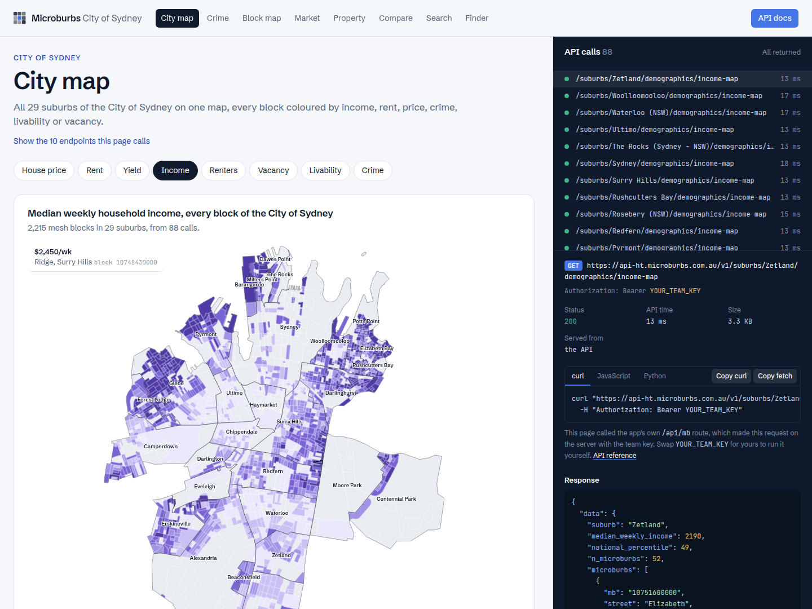

# City of Sydney explorer (Next.js)

A Next.js app (App Router, TypeScript) built on the Microburbs Hackathon API. It covers all 29 suburbs of the
City of Sydney and every address in them, across eight pages. Every page has a request inspector beside it
that lists the API calls it made. For each call you can see the URL, the status, how long it took and the
JSON that came back, and copy the same request as curl, JavaScript or Python.



| Page        | What it shows | Main endpoints |
|-------------|---------------|----------------|
| `/city`     | All 29 suburbs on one map, every mesh block coloured by income, house price, rent, yield, renters, vacancy, livability or crime, with a suburb league table | `suburbs/list`, `shapes/mesh-blocks`, `shapes/boundary`, `demographics/income-map`, `market/median-price-map`, `market/rent-map`, `market/yield-map`, `demographics/tenure`, `market/vacancy-map`, `lifestyle/livability-map`, `crime/by-mesh-block` |
| `/crime`    | A suburb against the national crime rate, the offences behind it, and the rate block by block | `crime/summary`, `crime/breakdown`, `crime/by-mesh-block`, `lifestyle/livability` |
| `/map`      | The same block-level layers as `/city`, for one suburb, with its highest and lowest blocks | the `/city` layers |
| `/market`   | Price, rent, yield and vacancy history for houses and units, past growth, the forecast range and the latest sales | `market/*-series`, `market/price-growth`, `forecast/sale`, `market/days-on-market`, `sales/recent` |
| `/property` | Address search, then the valuation and its range, value over time, the street against the suburb, sale and rental history, recent sales nearby on a map, hazards, transport and schools | `geocode/address`, `properties/{gnaf_id}/basics/all`, `valuation/avm`, `valuation/value-series`, `history/all`, `street/profile`, `comparables/recent-sales-nearby`, `risks/all`, `transport/nearby`, `schools/ranking`, `profile` |
| `/compare`  | All 29 suburbs in one sortable table: prices, rents, yields, five-year growth, days on market and crime | `suburbs/list`, `market/all`, `crime/summary` |
| `/search`   | Suburb type-ahead, then a snapshot: livability, what the suburb is like, amenities, age and income, and its neighbours | `geocode/suburb`, `hero/summary`, `lifestyle/*`, `demographics/all`, `hero/neighbours` |
| `/finder`   | Rank the suburbs on any of 46 fields, filter by ranges, and see the ranking on a map | `suburbs/finder/fields`, `suburbs/finder/search`, `suburbs/finder/count` |

Suburb endpoints are `/v1/suburbs/{name}/...` and property endpoints are `/v1/properties/{gnaf_id}/...`. The
full reference is at <https://api-ht.microburbs.com.au/docs>.

## Run it

You need Node.js 20.9 or newer, and your team's key.

```bash
npm install
cp .env.example .env.local      # then paste your team key into .env.local
npm run dev                     # http://localhost:3000
```

`npm run build && npm start` runs the production build. The project uses npm and ships a `package-lock.json`.
Dependency versions are pinned exactly.

## How the key stays secret

The browser never calls the API directly, and it never sees the key.

1. A page asks this app for `/api/mb/v1/suburbs/Surry%20Hills/crime/summary`.
2. The route handler in [`src/app/api/mb/[...path]/route.ts`](src/app/api/mb/[...path]/route.ts) reads
   `MICROBURBS_API_KEY` from the environment and calls
   `https://api-ht.microburbs.com.au/v1/suburbs/Surry%20Hills/crime/summary` with
   `Authorization: Bearer <key>`.
3. It returns the API's response body unchanged. It adds a few headers for the inspector, such as the
   upstream URL without the key and the upstream time.

The fetch code is in [`src/lib/server/microburbs.ts`](src/lib/server/microburbs.ts). It imports
`server-only`, so the build fails if a client component ever imports it. Never give the key a
`NEXT_PUBLIC_` prefix, because that would put it in the JavaScript bundle. The inspector always shows
`YOUR_TEAM_KEY` in place of the key.

The route only forwards `GET` requests under `/v1/`. If you deploy the app somewhere public, anyone could
use that route with your key, so put your own login in front of it first.

## Being polite to the API

Each key gets about 10 requests a second. The server-side client:

- sends at most 8 requests a second, and waits and retries when the API answers `429`;
- caches successful answers in memory for an hour, so a reload is instant and costs no requests;
- shares one upstream call when two requests for the same path arrive together.

The browser also sends no more than 6 requests to the app at once. The first visit to `/city` makes 88
calls (mesh blocks, outline and one layer for each suburb) and takes 10 to 20 seconds; suburbs fill in as
their data arrives. After that, the page loads from the cache.

## Things worth knowing about the API

- **Suburb names are exact ABS names.** Some have suffixes, such as `Glebe (NSW)` and
  `The Rocks (Sydney - NSW)`. Take them from `GET /v1/suburbs/list` or `GET /v1/geocode/suburb?q=` rather
  than typing them. Encode them in the path: `/v1/suburbs/Glebe%20(NSW)/...`.
- **No data is not an error.** You get HTTP 200 with `{"data": null, "available": false, "message": ...}`.
  Every panel here handles `data === null` and shows the message.
- **Anything outside the City of Sydney returns 403**, and the geocoders answer outside addresses with
  `data: null`.
- **Block-level layers join on the mesh-block code.** `shapes/mesh-blocks` gives polygons with
  `properties.mb`; the `*-map` endpoints give values keyed by the same `mb`. House-price and rent maps cover
  houses only, so apartment-only blocks (most of the CBD) have no figure there.
- **The finder ranks; it doesn't always give values.** `finder/search` returns a `rank` for every suburb, and
  values only for the top and bottom five when sorting by a median or a growth figure.

## Project layout

```
src/
  app/
    api/mb/[...path]/route.ts   the only place the browser's requests leave the app
    page.tsx                    index of the demos
    city/ crime/ map/ market/ property/ compare/ search/ finder/
  components/
    Inspector.tsx               the request inspector
    ChoroplethMap.tsx           GeoJSON to SVG, with no map library
    LineChart.tsx               SVG time series
    PageShell.tsx               page frame, panels, loading and empty states
  lib/
    server/microburbs.ts        server-only API client: key, pacing, retries, cache
    api-store.tsx               useApi(path): fetches through /api/mb and logs each call for the inspector
    api.ts                      paths, response types, curl/JS/Python snippets
    layers.ts                   the block-level map layers
    pages.ts                    the demo list (nav and index), plus the "More demos" links
```

To add a page, add an entry to `src/lib/pages.ts` and create `src/app/<slug>/page.tsx`. In the page,
render `<PageShell slug="<slug>">` and fetch with `useApi("/v1/...")`. Wrap each block in
`<Panel calls={[result.call]}>` so its calls are linked to the inspector.

The maps and charts are plain SVG, so the only runtime dependencies are Next.js, React and `server-only`.
Styling uses Tailwind CSS v4.
