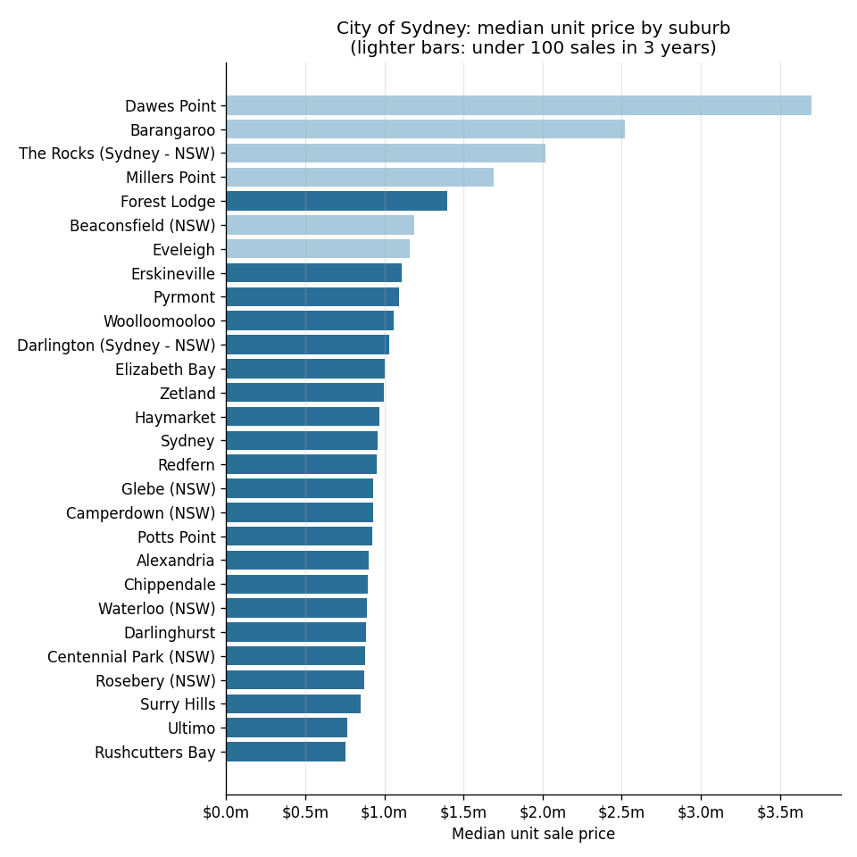

# Python quickstart: your first 10 minutes with the Microburbs API

A short, copyable walk-through for Python teams. In about 100 lines of code it goes from setting
your key to a table and a chart covering all 29 City of Sydney suburbs:

1. set your key from an environment variable;
2. find a suburb and an address with the geocode endpoints;
3. look up one property: its profile, estimated value and sale history;
4. loop over every suburb into a pandas DataFrame of market figures (median unit and house
   price, weekly rent, gross yield, 1- and 5-year growth, sales count), politely and with
   missing data handled;
5. chart it;
6. pull 2021 Census figures from area statistics.

It comes two ways, with the same steps and the same explanations:

- [`quickstart.ipynb`](quickstart.ipynb): a Jupyter notebook, saved with the output of a
  real run so you can read it here on GitHub without running anything;
- [`quickstart.py`](quickstart.py): a plain script for people who don't use notebooks.



## Run it

You need Python 3.10 or newer and your team's API key.

```bash
python -m venv .venv && source .venv/bin/activate   # Windows: .venv\Scripts\activate
pip install -r requirements.txt
cp .env.example .env    # then open .env and paste your key after MICROBURBS_API_KEY=
```

Then either:

```bash
python quickstart.py     # prints each step; writes out/city_of_sydney_market.csv and out/unit_prices.png
jupyter notebook quickstart.ipynb
```

The script takes about 15 seconds. `.env` is gitignored, so your key stays out of git. If
you'd rather not use a file, `export MICROBURBS_API_KEY=...` works too.

## The helper client

[`microburbs_client.py`](microburbs_client.py) is a small client (about 100 lines) built on `requests`.
Copy it into your own project.

```python
from microburbs_client import Microburbs, MicroburbsError

mb = Microburbs()  # reads MICROBURBS_API_KEY, and MICROBURBS_API_BASE if set

mb.get("/v1/suburbs/Glebe (NSW)/market/median-rent")
# {'area_name': 'Glebe (NSW)', 'area_level': 'suburb', 'house': ..., 'unit': ..., 'as_of': ...}

mb.get("/v1/geocode/address", address="26 Tudor Street, Surry Hills")  # query params as kwargs
```

- Write paths as they appear in the docs. Suburb names go in as-is (`Glebe (NSW)`); the
  client URL-encodes them.
- `get()` returns the `data` part of the response, or `None` when the API has no figure for
  that place (it answers `{"data": null, "available": false, ...}` rather than an error).
  Always allow for `None`.
- On `429 Too Many Requests` or a brief 5xx error it waits and retries, using `Retry-After`
  when present, otherwise backing off 1, 2, 4… seconds.
- Anything else, such as asking for a suburb outside the hackathon area (403), raises
  `MicroburbsError` with the API's own message.

The rate limit is about 10 requests a second per key. The suburb loop runs 4 requests at a
time; keep it under 8.

## Endpoints used

| Step | Endpoint |
|---|---|
| 1 | `GET /v1/ping` |
| 2 | `GET /v1/geocode/suburb?q=...`, `GET /v1/geocode/address?address=...` |
| 3 | `GET /v1/properties/{gnaf_id}/profile`, `/basics/all`, `/valuation/avm`, `/sale-history` |
| 4 | `GET /v1/suburbs/list`; per suburb `/market/median-sale-price`, `/market/median-rent`, `/market/yield-pct`, `/market/price-growth`, `/sales/summary` |
| 6 | `GET /v1/area-stats/fields?query=...`, `GET /v1/area-stats/SAL/{suburb}/values?fields=...` |

Full reference: https://api-ht.microburbs.com.au/docs

## Good to know

- **Coverage is the City of Sydney only**: 29 suburbs and every address in them. Anything
  else returns 403.
- **Suburb names are exact ABS names**, some with suffixes: `Glebe (NSW)`,
  `Darlington (Sydney - NSW)`. Use `/v1/geocode/suburb` to turn what a user typed into the
  right name.
- **Small suburbs have noisy medians.** Barangaroo and Dawes Point have under 20 sales in
  three years, so one unusual sale moves their figures a lot. The `sales_3y` column is there
  so you can tell.
- Yield and growth come back as fractions: `0.045` means 4.5%.

## Files

```
quickstart.ipynb       the notebook, with outputs
quickstart.py          the same steps as a script, in `# %%` cells (VS Code and PyCharm can run it cell by cell)
microburbs_client.py   the helper client
requirements.txt       pinned dependencies
.env.example           copy to .env and add your key
docs/chart.png         the chart from step 5
```
