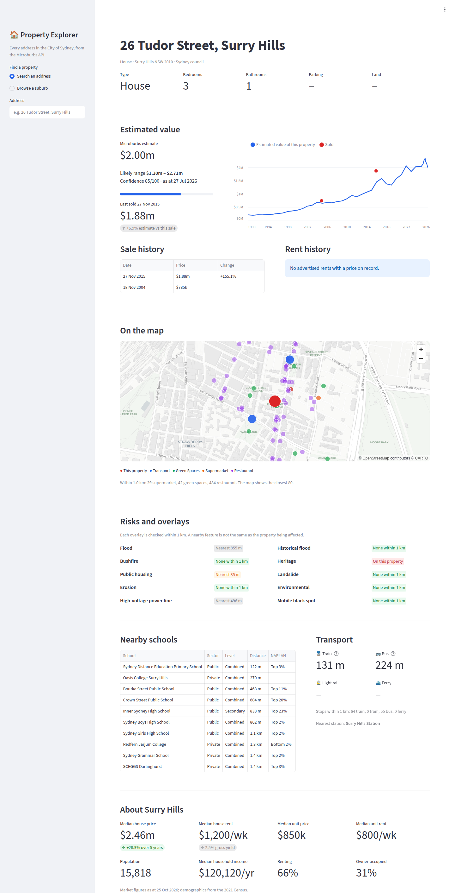

# Property Explorer (Streamlit)

A one-page property report for any address in the City of Sydney, built on the
[Microburbs Hackathon API](https://api-ht.microburbs.com.au/docs). Type an
address (or pick a suburb, then one of its recent sales) and you get:

- **What the property is**: dwelling type, bedrooms, bathrooms, parking, land area
- **Estimated value** with its likely range and confidence score, against the last sale
- **Value over time**: the modelled value of the property (houses), or the suburb
  median for its type (units), with its past sales plotted as dots
- **Sale and rent history**
- **A map** of the property, its nearest stations and stops, and nearby parks,
  supermarkets and restaurants
- **Risks and overlays** within 1 km: flood, bushfire, heritage, power lines and more
- **Nearby schools** with NAPLAN rank, and **transport** distances
- **The suburb**: median price and rent for houses and units, 5-year growth,
  yield, population, household income, renting vs owner-occupied

Raw API responses are in an expander at the bottom, so you can see exactly what
each section was built from.



## Run it locally

You need Python 3.10+ and a hackathon API key.

```bash
pip install -r requirements.txt
cp .streamlit/secrets.toml.example .streamlit/secrets.toml   # then paste your key into it
streamlit run streamlit_app.py
```

Use a virtual environment if you like (`python -m venv .venv && source .venv/bin/activate` first).

Prefer an environment variable? Skip the `secrets.toml` step and run
`MICROBURBS_API_KEY=your-key streamlit run streamlit_app.py` instead. The app
reads `st.secrets["MICROBURBS_API_KEY"]` first and falls back to the
environment variable. `.streamlit/secrets.toml` and `.env` are gitignored;
never commit a real key.

## Deploy on Vercel (container)

The folder has a `Dockerfile`, so any host that runs containers can serve it. On Vercel:

1. Import the GitHub repo as a new project.
2. Set **Framework** to **Container** and **Root Directory** to `streamlit-property-explorer`.
3. Add an environment variable `MICROBURBS_API_KEY` with your key, then deploy.

The container listens on `$PORT` (default 80). To try the image locally:

```bash
docker build -t property-explorer .
docker run --rm -p 8501:8501 -e PORT=8501 -e MICROBURBS_API_KEY=your-key property-explorer
```

It also runs unchanged on Streamlit Community Cloud: set the main file to
`streamlit-property-explorer/streamlit_app.py` and paste the `secrets.toml`
line into the app's Secrets.

## Shareable links

The current selection lives in the URL, for example
`/?gnaf=GANSW705970502` (one property), `/?q=26+Tudor+Street...&gnaf=...`
(an address search) or `/?suburb=Glebe+%28NSW%29&gnaf=...` (browsing a suburb).
Any link opens straight onto that report. It also means a dropped connection
doesn't lose your place: some hosts close Streamlit's WebSocket every few
minutes, and the fresh session that reconnects restores itself from the URL.

## Files

| File | What it does |
|---|---|
| `streamlit_app.py` | The app: sidebar search, then one function per report section |
| `microburbs.py` | A tiny API client with no Streamlit dependency (reuse it in notebooks) |
| `requirements.txt` | Pinned dependencies |
| `Dockerfile` | Container image for Vercel or any Docker host |
| `.streamlit/secrets.toml.example` | Template for your key |
| `.streamlit/config.toml` | Theme colour; hides the developer menu from visitors |

## Endpoints used

Finding a property:

- `GET /v1/geocode/address?address=...`: address search, returns GNAF ids
- `GET /v1/suburbs/list`: the 29 suburbs in the hackathon area
- `GET /v1/suburbs/{suburb}/sales/recent?limit=100`: recent sales, used as the "browse a suburb" picker

The property report (all keyed by GNAF id):

- `GET /v1/properties/{gnaf_id}/basics/all`: type, beds, baths, parking, land
- `GET /v1/properties/{gnaf_id}/profile`: suburb, postcode, council
- `GET /v1/properties/{gnaf_id}/valuation/all`: the automated valuation (AVM)
- `GET /v1/properties/{gnaf_id}/valuation/value-series`: modelled value over time (houses only)
- `GET /v1/properties/{gnaf_id}/history/all`: sale and rent history
- `GET /v1/properties/{gnaf_id}/risks/all`: every risk overlay within 1 km
- `GET /v1/properties/{gnaf_id}/schools/all`: nearby schools with NAPLAN rank
- `GET /v1/properties/{gnaf_id}/transport/nearby`: nearest train, bus, light rail, ferry, plus the property's coordinates
- `GET /v1/properties/{gnaf_id}/amenities/nearby`: parks, supermarkets, restaurants for the map

The suburb panel (keyed by the exact ABS suburb name, e.g. `Glebe (NSW)`):

- `GET /v1/suburbs/{suburb}/market/all`: median price and rent, growth, yield, price series
- `GET /v1/suburbs/{suburb}/hero/summary`: population
- `GET /v1/suburbs/{suburb}/demographics/all`: household income
- `GET /v1/suburbs/{suburb}/demographics/tenure`: renting vs owner-occupied

## How it handles the API

- **Envelope.** Successful calls return `{"data": ...}`. When there's nothing to
  show the API still returns HTTP 200, with `{"data": null, "reason": ..., "message": ...}`.
  `microburbs.py` turns every response into a `Result` with a `status` of `ok`,
  `empty`, `outside` or `error`, so each section just checks `result.ok` and
  shows a friendly note otherwise (units have no value series, many properties
  have no rent on record, and so on).
- **Outside the area.** Anything outside the City of Sydney returns HTTP 403
  (and an address search returns `reason: "outside_hackathon_area"`). The app
  says so plainly instead of showing an error.
- **Caching.** Each report is fetched once with `st.cache_data(ttl=3600)` and
  reused for an hour; switching between addresses you've already viewed costs
  no API calls. A failed call raises inside the cached function, so errors are
  never cached.
- **Politeness.** The ~13 calls behind a report run on at most 6 threads, under
  the API's limit of about 10 requests a second.

## Ideas to extend it

- Compare two addresses side by side (call `load_property` twice).
- Add comparable sales from `/v1/properties/{gnaf_id}/comparables/all`.
- Draw the risk overlays as polygons: `/v1/properties/{gnaf_id}/risks/all?geojson=true`
  returns GeoJSON you can pass to a pydeck `GeoJsonLayer`.
